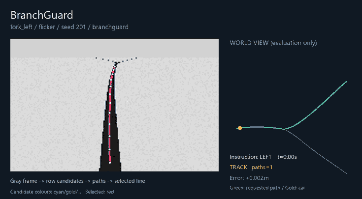
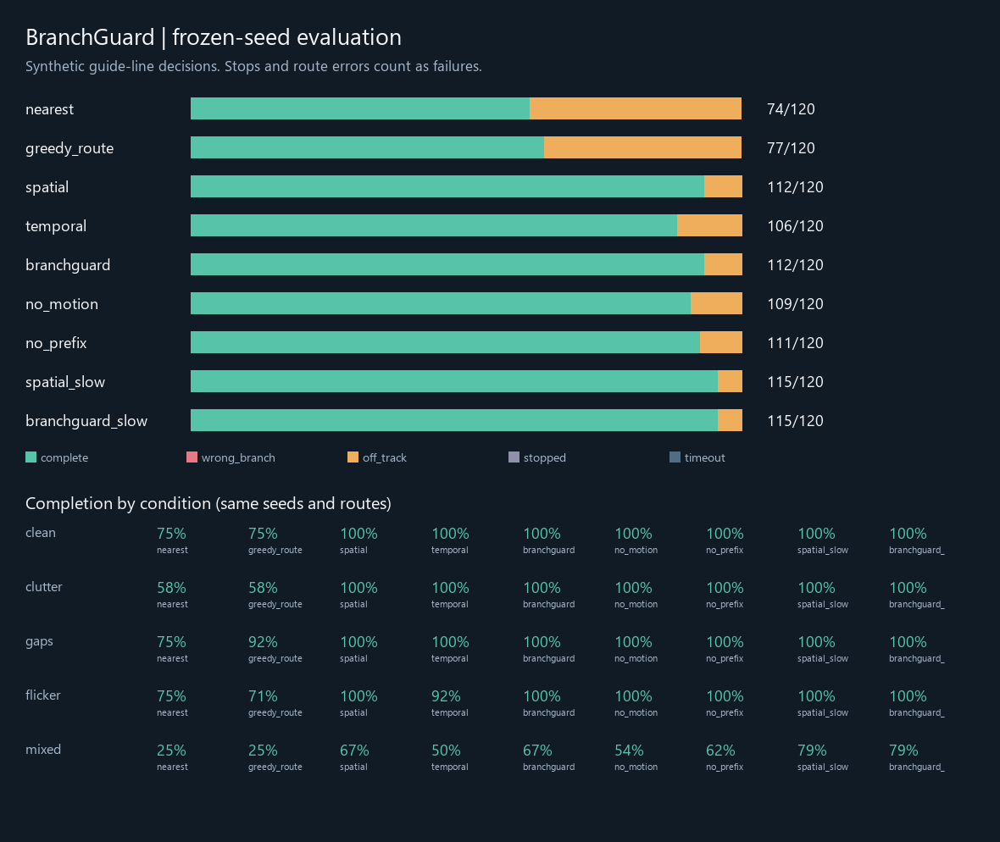
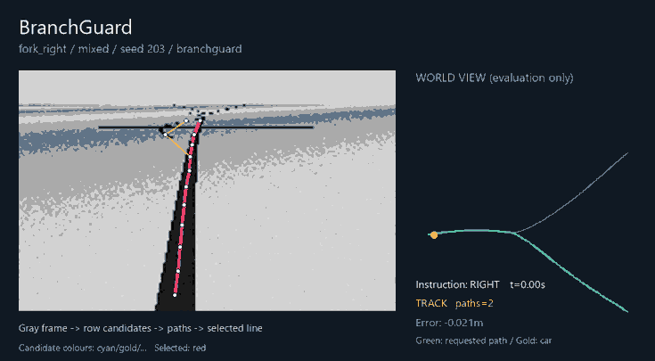

# BranchGuard

C99 实现的多候选引导线选择：岔路指令、近端路径关联与换线确认。

摄像头看到两条线时，逐行挑最近的点，未必能拼出一条正确的路。BranchGuard 从 188×120 灰度图中保留多条路径，按左／直／右指令选择，并用相对运动修正上一帧路径。新路径的近端突然跳变时，先确认它是否持续存在。



演示选用确认种子 201 的左岔路／短时错误线曝光场景。左侧显示 C 核心实际使用的灰度图、扫描点和候选路径；右侧世界图只用于展示，不参与决策。演示是成功案例，下面同时保留失败案例和全部统计。

## 实现

`bg_extract()` 每行提取最多 6 个暗色区间中心。`bg_search()` 用束宽 24 的搜索连接扫描点，允许跳过缺失行，最终保留最多 8 条路径。

选路时，几何代价、路线指令和近端连续性共同参与评分。上一帧路径先用编码器行进增量和陀螺仪转角增量移到当前坐标系。关联主要比较车前约 0.24–0.58 m 的路段：正常岔路可以共用近端路径、在远端分开，不应仅因远端不同就推迟转弯。

近端差异超过阈值时，新的选择需持续 0.12 s 才接受；等待期间沿用旧路径并降低速度建议。完全丢线时最多保持 0.20 s，随后给出零速建议。所有方法共用同一几何转向与曲率限速，控制器不会读取模拟赛道的真实路径。

核心使用固定数组，不分配堆内存。具体代价、坐标变换和阈值见 [算法说明](docs/ALGORITHM.zh-CN.md)。

## 实验结果

参数冻结后，用两组不同种子各运行 1080 次：4 类场景 × 5 类干扰 × 6 个种子 × 9 种方法。第二组结果如下：

| 方法 | 完成指定路线 |
|---|---:|
| 逐行最近点 `nearest` | 74/120 |
| 带路线偏好的逐行贪心 `greedy_route` | 77/120 |
| 单帧多候选 `spatial` | 112/120 |
| 近端关联、不做换线确认 `temporal` | 106/120 |
| 完整方案 `branchguard` | 112/120 |
| 取消运动修正 `no_motion` | 109/120 |
| 不区分近端与远端 `no_prefix` | 111/120 |
| 单帧多候选，限速 0.55 m/s | 115/120 |
| 完整方案，限速 0.55 m/s | 115/120 |

多候选搜索的收益较明确。完整方案与单帧多候选方案的总体完成率相同，而且各有 6 次只由自己完成的运行，不能说完整方案普遍更可靠。第一组也是 113/120 对 112/120，差距很小。

换线确认的作用主要体现在短时错误曝光：第二组 24 对运行都完成时，完整方案相对单帧多候选的 **RMS 误差配对差中位数为 −4.23 mm，转向总变化差为 −2.04 rad**。双方统一限速 0.55 m/s 后，对应差值为 −2.34 mm 与 −1.92 rad。这是人为设置的 80 ms 错误线扰动，不能推断为任意误检条件下的表现。正常场景里，时序模块往往几乎不改变结果。



混合干扰仍会失败。以下为右岔路／混合干扰／确认种子 203 的出界运行：



[实验报告](docs/EXPERIMENTS.zh-CN.md)包含配对耗时、误差和失败分类。[第一组 CSV](results/evaluation/runs.csv)与[确认组 CSV](results/confirmation/runs.csv)保留所有运行；参数、种子和代码哈希在相邻 `protocol.json` 中。早期开发结果另存于 `results/`，不并入最终成绩。

## 运行

需要 Python 3.10+ 和 C 编译器。可使用 requirements 中的 Zig，或本机 GCC／Clang。首次运行会编译 C 核心到 `build/`。本地已在 Windows x64 / Python 3.12 验证；仓库另提供 Linux CI 配置。

```bash
python -m venv .venv
# Windows PowerShell
.venv\Scripts\Activate.ps1
# Linux / macOS: source .venv/bin/activate
pip install -r requirements.txt

python -m unittest discover -s tests -v
python run_benchmark.py --quick --out results/quick
python make_demo.py --scenario fork_left --condition flicker --seed 201
```

复现最终评估：

```bash
python run_benchmark.py --workers 4 --seeds 6 --seed-start 101 --out results/evaluation
python run_benchmark.py --workers 4 --seeds 6 --seed-start 201 --out results/confirmation
python make_report.py --input results/confirmation
python make_demo.py --scenario fork_right --condition mixed --seed 203 --prefix failure
```

单张图检查：`python analyse_frame.py image.png --route left --out build/frame`。图像必须是已标定的 188×120，引导线定义和投影应与扫描器一致；这个入口不测试跨帧确认。设置 `BRANCHGUARD_ZIG` 可以指定 Zig 路径，`CC` 可以指定其他编译器。

## 代码入口

| 文件 | 内容 |
|---|---|
| `core/branchguard.c` | 图像扫描、束搜索、坐标变换、路径选择与确认 |
| `core/branchguard.h` | 固定容量结构与 C 接口 |
| `branchguard/native.py` | 编译与 ctypes 接口 |
| `branchguard/simulator.py` | 图像渲染、车辆模型和评分 |
| `run_benchmark.py` | 多种子对比与原始数据输出 |
| `tests/test_core.py` | 12 项行为检查 |

## 实车适配与范围

当前模型使用**黑色中心引导线**，没有验证传统竞赛白底黑边赛道。后者需先配对边界、输出候选走廊中心，再接入搜索与决策接口。合成投影参数也需替换为实测标定。路线指令由上层提供，本项目不包含多路口地图导航、环岛处理或障碍物避让。

RT1064 是预期适配平台，尚无实车成绩或 MCU 耗时测量。车辆模型包含执行器滞后，但没有侧滑和复杂轮胎动力学。移植接口见 [适配说明](docs/PORTING.zh-CN.md)，阅读顺序见 [代码阅读](docs/LEARNING.zh-CN.md)。

相关方法与具体差异见 [References](docs/REFERENCES.md)。束搜索、跨帧关联和持续性检查已有研究基础；本项目的工程贡献是固定资源下的组合实现、近端关联设计和可复查实验，不宣称研究首创。

MIT License.
